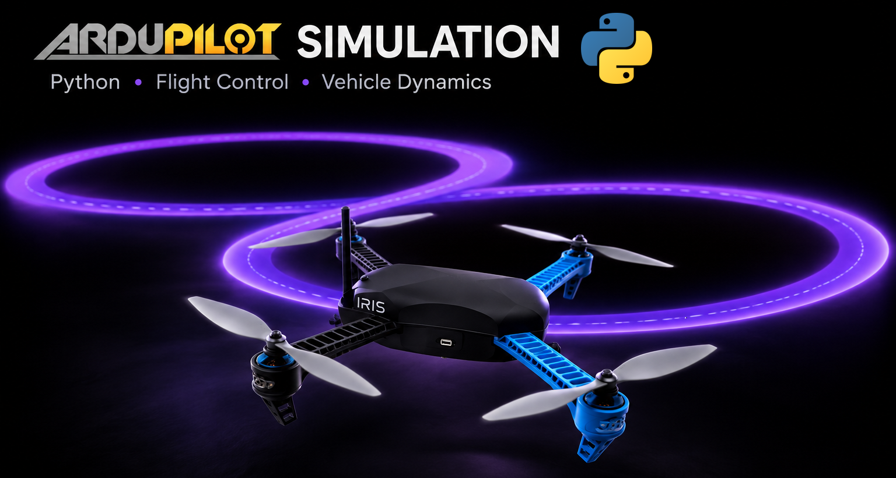
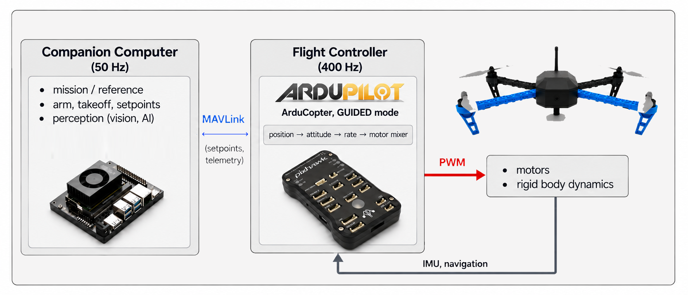
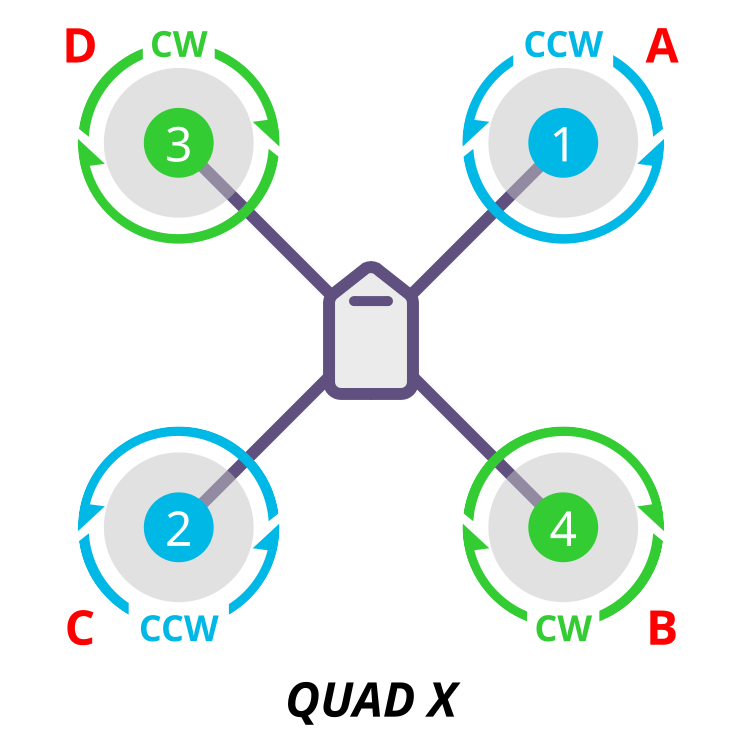

- [](https://colab.research.google.com/github/c4dynamics/c4dynamics/blob/main/docs/source/programs/ardupilot_sim/ardupilot_fig8.ipynb) ← Click to open in Google Colab
- To download this notebook, click the download icon in the toolbar above and select the .ipynb format.
- For any questions or comments, please open an issue on the [c4dynamics issues page](https://github.com/c4dynamics/c4dynamics/issues).

<h1 style="font-family: Arial, sans-serif; font-weight: 800;">
  
  <span style="color: #555555;">ARDU</span><span style="color: #FFD343;">PILOT</span>
  PYTHON SIMULATOR
</h2>

## Figure-8 Tracking with ArduCopter-4.7.1 and 3DR IRIS in Python

*Fly your algorithm against ArduPilot in Python before you fly it for real.*



This notebook flies a simulated drone through a figure-8 under the control of ArduPilot:

- **Firmware:** [ArduPilot](https://ardupilot.org/) **ArduCopter Copter-4.7.1**. Its position, attitude and rate controllers and its motor mixer are ported line by line to Python, with the stock parameter names and defaults, and fly in `GUIDED` mode.
- **Drone:** the **3DR Iris** quadcopter ($1.5\,kg$, quad-$X$), with mass, inertia and rotor data from the Gazebo `iris.sdf` model. Its flight controller is a **Pixhawk** board, which carries the $IMU$ and runs the ArduCopter firmware.
- **Mission:** take off to $5\,m$, fly one *figure-8* ($\infty$), $8\,m$ east–west by $4\,m$ north–south, in about $63\,s$, then return to the origin and land. A companion-computer script streams the reference to the autopilot as MAVLink position targets.
- **Wind sweep:** the same mission flown $24$ more times, in a constant wind of $4$, $8$ and $12\,m/s$ from $8$ compass directions, to see how the stock tuning holds up in wind. The flights are independent and run in parallel, one per CPU core.
- **C4DYNAMICS:** true drone dynamics, pixhawk sensors, rigidbody models. 

> ⚠️ **Disclaimer: no $EKF3$.** ArduPilot's state estimator, $EKF3$, is **not** ported. The flight controller flies on the vehicle's *true* attitude, position and velocity (with optional white noise), not on a solution fused from $IMU$, $GPS$, compass and barometer. Estimation errors, filter lag, $GPS$ glitches and innovation-gate behaviour are therefore absent, and the tracking results in Section 5 are a best case: on a real vehicle, expect larger position errors. 


For a hand-written 3-loop cascade PID that flies the same *figure-8* ($\infty$), see the [Quadcopter Cascade-PID example](https://c4dynamics.github.io/c4dynamics/programs/pid_cascade/quadcopter_pid.html).

## Goal

1. Build a closed loop of *companion computer* → *ArduPilot* → *vehicle* in which ArduPilot runs its real control law, with its real parameter names and defaults.
2. Fly the *figure-8* in `GUIDED` mode and evaluate how well the stock ArduCopter tuning tracks it on a 3DR Iris airframe.
3. Use the simulator the way it is meant to be used: change an ArduPilot parameter and see the effect before going to the field.
4. Run a statistical experiment that a single test flight cannot: sweep the wind speed and direction and find where the tuning runs out of margin.

## Table of Contents

1. [Introduction](#1.-Introduction)
2. [Dynamics](#2.-Dynamics)
3. [Sensors](#3.-Sensors)
4. [Main Loop](#4.-Main-Loop)
5. [Results](#5.-Results)
6. [Wind Sweep](#6.-Wind-Sweep)
7. [Summary](#7.-Summary)

---

## 1. Introduction

### 1.1. Setup

```python


import sys
# On Google Colab, install c4dynamics -- it ships this example's ArduPilot port too.
# Pin >=2.6.0: this notebook uses quatbody, eqm.quadeqm and the ArduPilot port,
# introduced in that release.
if 'google.colab' in sys.modules:
    !pip install -q "c4dynamics>=2.6.0"

# joblib runs the wind sweep of Section 6 in parallel (preinstalled on Colab and Anaconda)
try:
    import joblib
except ImportError:
    %pip install -q joblib

import numpy as np
import c4dynamics as c4d
assert tuple(map(int, c4d.__version__.split('.')[:2])) >= (2, 6), (
    f'this notebook needs c4dynamics >= 2.6.0, found {c4d.__version__}')
from matplotlib import pyplot as plt
from scipy.integrate import solve_ivp

from c4dynamics.utils.use_cases import ardupilot, pixhawk


```


- Two supporting files hold the flight controller: the ArduCopter port, [ardupilot](https://github.com/c4dynamics/c4dynamics/blob/main/c4dynamics/utils/use_cases/ardupilot.py) — the "firmware" of this simulation — and the board it runs on, [pixhawk](https://github.com/c4dynamics/c4dynamics/blob/main/c4dynamics/utils/use_cases/pixhawk.py), which carries the sensors.
- Everything else — the vehicle dynamics, the main loop, the plots — is written in this notebook.

### 1.2. ArduPilot in the Loop

On a real drone, two computers fly the vehicle: 
- A flight controller (required) that keeps the vehicle stable and on target. 
- A Companion computer (optional) that runs the mission and commands the autopilot. 

In addition, the vehicle itself carries the computers, the motors, and the physical properties. 



This simulation keeps this split, and each block is a separate object in the main loop:

| Block | File | Rate |
|---|---|---|
| Companion computer | ▸ this notebook: main loop — figure-8 reference. <br> ▸ MAVLink-like calls. <br> ▸ sends position / velocity / acceleration targets in $NED$ (`SET_POSITION_TARGET_LOCAL_NED`). | $50\,Hz$ |
| Flight controller | ▸ [pixhawk](https://github.com/c4dynamics/c4dynamics/blob/main/c4dynamics/utils/use_cases/pixhawk.py): the board and its sensors. <br> ▸ [ardupilot](https://github.com/c4dynamics/c4dynamics/blob/main/c4dynamics/utils/use_cases/ardupilot.py): the firmware. <br> ▸ reads an $IMU$ sample and a navigation solution and returns four $PWM$ values. | $400\,Hz$ |
| Vehicle | ▸ 3DR Iris model: a [quatbody](https://c4dynamics.github.io/c4dynamics/api/states.lib.quatbody.html) with motors | $400\,Hz$ |


### 1.3. The ArduCopter Port

The flight controller is a line-by-line Python port of the ArduPilot libraries that fly a multicopter in `GUIDED` mode. Function names and parameter names follow the C++ source, so the two can be read side by side.

| ArduPilot library | Role | Main parameters |
|---|---|---|
| `AC_PosControl` | position (sqrt-$P$) → velocity ($PID$) → acceleration; vertical: acceleration ($PID$) → throttle | `PSC_*`, `WP_SPD*`, `WP_ACC*` |
| `AC_AttitudeControl_Multi` | thrust vector + heading → quaternion attitude error → body-rate target; body-rate $PIDs$ | `ATC_*` |
| `AP_MotorsMatrix` | roll / pitch / yaw / throttle → four motor outputs (quad $X$), thrust linearisation, $PWM$ | `MOT_*` |
| `AC_PID`, `AP_Math` | the $PID$ family, square-root controller, jerk-limited kinematic shaping | |

The fast loop runs in the same order as `ArduCopter/Copter.cpp`:

```
read IMU -> rate controller -> motors output -> read AHRS -> flight mode (position + attitude control)
```

so the rate PIDs act on the body-rate target computed one tick earlier, as on the real vehicle.

**State estimation is not ported.** Instead of running $EKF3$, the $AHRS$ takes the navigation solution from the simulator (Section 3). Spool-up ramps, notch filters, battery compensation and terrain following are also left out. Takeoff and landing are simplified versions of ArduCopter's.

The flight controller is created with its default parameters. Any ArduPilot parameter can be overridden by name, exactly as in a `.param` file:

```python


copter = ardupilot.ArduCopter()

print(f"{len(copter.params)} parameters, e.g.:")
for name in ['SCHED_LOOP_RATE', 'ATC_ANG_PIT_P', 'ATC_RAT_PIT_P', 'ATC_RAT_PIT_I', 'ATC_RAT_PIT_D',
             'PSC_NE_POS_P', 'PSC_NE_VEL_P', 'PSC_D_ACC_P', 'MOT_THST_EXPO', 'MOT_THST_HOVER']:
    print(f"  {name:16s} = {copter.params[name]}")


```


Edit the dictionary to try your own values (an unknown name raises an error, so typos do not pass silently):

```python


ardupilot_params = {
    # e.g. 'ATC_RAT_PIT_P': 0.2,
}


```


---

## 2. Dynamics

### 2.1. Frames

This example uses ArduPilot's conventions throughout the vehicle and the flight controller:

- Earth frame $NED$: $x$ north, $y$ east, $z$ down.
- Body frame $FRD$: $x$ forward, $y$ right, $z$ down.

The companion computer keeps the figure-8 in $ENU$ ($x$ east, $y$ north, $z$ up), as in the Cascade-PID example, and converts to $NED$ when it sends a target (Section 4.2) — the same place MAVROS or a companion script does it.

### 2.2. Rigid Body

The vehicle is a [quatbody](https://c4dynamics.github.io/c4dynamics/api/states.lib.quatbody.html), a rigid body whose attitude is a unit quaternion, with the 13-state vector

$$
\mathbf{x} = \begin{bmatrix} x & y & z & v_x & v_y & v_z & q_w & q_x & q_y & q_z & p & q & r \end{bmatrix}^T
$$

position and velocity in $NED$ [$m$, $m/s$], the attitude quaternion (scalar first) and $FRD$ body rates [$rad/s$]. 

**Translational dynamics.**  
Thrust $T$ acts along $-z$ of the body, linear drag opposes the body velocity $\mathbf v_b = [BI]\cdot\mathbf v$:

$$
\begin{aligned}
\mathbf F_b &= 
\begin{bmatrix} 
0 \\ 0 \\ -T 
\end{bmatrix} - 
\begin{bmatrix} 
A_x u \\ A_y v \\ A_z w 
\end{bmatrix}
\\
\\
\qquad
\dot{\mathbf v} &= \frac{[BI]^{T\,} \cdot \mathbf F_b}{m} + \begin{bmatrix} 0 && 0 && g \end{bmatrix}^T
\end{aligned}
$$

where $[BI]$ is the body-from-inertial $DCM$ of the quaternion ([quat2dcm](https://c4dynamics.github.io/c4dynamics/api/generated/rotmat/c4dynamics.rotmat.rotmat.quat2dcm.html)).

**Rotational dynamics.**  
Euler's equations with rotor moments $\boldsymbol\tau$ and rotational damping $A_r$:

$$
I \dot{\boldsymbol\omega} = \boldsymbol\tau - A_r \boldsymbol\omega - \boldsymbol\omega \times I \boldsymbol\omega,
\qquad \boldsymbol\omega = [p, q, r]^T
$$

and the quaternion kinematics

$$
\begin{aligned}
\dot q_w &= -\tfrac{1}{2}(q_x p + q_y q + q_z r), \qquad    \\
\dot q_x &= \tfrac{1}{2}(q_w p + q_y r - q_z q), \qquad     \\
\dot q_y &= \tfrac{1}{2}(q_w q - q_x r + q_z p), \qquad     \\
\dot q_z &= \tfrac{1}{2}(q_w r + q_x q - q_y p)
\end{aligned}
$$

The quaternion is renormalized to unit length after every step.

**Ground.** 
The vehicle cannot go below $z = 0$: while it rests on the ground, the ground carries its weight.

These equations, with the rotor model of Section 2.3, 
are c4dynamics' quadcopter model [quadeqm](https://c4dynamics.github.io/c4dynamics/api/generated/eqm/c4dynamics.eqm.quadcopter.quadeqm.html), 
the same model the [Cascade-PID](https://c4dynamics.github.io/c4dynamics/programs/pid_cascade/quadcopter_pid.html) 
and [EKF](https://c4dynamics.github.io/c4dynamics/programs/ekf_estimation/quad_ekf.html) examples fly.  
`frame='NED'` selects the $NED$ / $FRD$ convention used here, and the 13-state vector selects the quaternion form.

### 2.3. Motors

ArduPilot numbers the motors of a quad $X$ as follows (top view):

<div style="text-align: center;">
    
</div>

Each rotor $i$ at body position $(x_i, y_i)$ produces thrust $F_i = k_T \Omega_i^2$ and reaction torque $k_Q \Omega_i^2$, with spin direction $d_i = +1$ for $CCW$, $-1$ for $CW$:

$$
T = \sum F_i, \qquad
\boldsymbol\tau = \begin{bmatrix} -\sum y_i F_i \\ \sum x_i F_i \\ \sum d_i k_Q \Omega_i^2 \end{bmatrix}
$$

**ESC and motor.**  
The flight controller outputs $PWM$ (Pulse Width Modulation). The $ESC$ (Electronic Speed Controller) maps it to a normalized command $u = (PWM - 1000)/1000$, the motor starts producing thrust above $u_{min}$ (spin-min) and saturates at $u_{max}$ (spin-max).  
Within that range the thrust follows the quadratic curve ArduPilot assumes (`MOT_THST_EXPO`, $a = 0.65$):

$$
e = \frac{u - u_{min}}{u_{max} - u_{min}}, \qquad
\frac{F}{F_{max}} = (1-a)\,e + a\,e^2
$$

The rotor speed follows its command through a first-order lag, faster spinning up than down.

### 2.4. Vehicle Parameters

The airframe is the 3DR Iris, with mass, inertia and rotor data from the Gazebo `iris.sdf` model (see [iris_quadcopter.py](https://github.com/c4dynamics/c4dynamics/blob/main/c4dynamics/utils/use_cases/iris_quadcopter.py)). Rotor positions are given in $FRD$, in ArduPilot's motor order:

```python


iris = {
    'm'        : 1.5,        # mass [kg]
    'g'        : 9.80665,    # gravity [m/s^2]
    'Ixx'      : 0.0347563,  # roll inertia [kg.m^2]
    'Iyy'      : 0.0458929,  # pitch inertia [kg.m^2]
    'Izz'      : 0.0977,     # yaw inertia [kg.m^2]
    'kT'       : 8.5485e-6,  # thrust coefficient [N/(rad/s)^2]
    'kQ'       : 1.6e-7,     # torque coefficient [N.m/(rad/s)^2]
    'omega_max': 838.0,      # max rotor speed [rad/s]
    'tau_up'   : 0.0125,     # motor spin-up time constant [s]
    'tau_down' : 0.025,      # motor spin-down time constant [s]
    'rotor_pos': np.array([[ 0.13,  0.22],    # motor 1  front-right  [m] (x fwd, y right)
                           [-0.13, -0.20],    # motor 2  rear-left
                           [ 0.13, -0.22],    # motor 3  front-left
                           [-0.13,  0.20]]),  # motor 4  rear-right
    'rotor_dir': np.array([1, 1, -1, -1]),    # +1 CCW, -1 CW
    'thrust_expo': 0.65,     # thrust curve
    'spin_min' : 0.15,       # ESC command where thrust starts
    'spin_max' : 0.95,       # ESC command where thrust saturates
    'Ax'       : 0.30,       # linear drag, body x [N/(m/s)]
    'Ay'       : 0.30,       # linear drag, body y [N/(m/s)]
    'Az'       : 0.25,       # linear drag, body z [N/(m/s)]
    'Ar'       : 0.002,      # rotational damping [N.m/(rad/s)]
}

F_max = iris['kT'] * iris['omega_max']**2
print(f"max thrust per motor {F_max:.2f} N | thrust-to-weight {4 * F_max / (iris['m'] * iris['g']):.2f} "
      f"| hover thrust fraction {iris['m'] * iris['g'] / (4 * F_max):.3f}")


```


The Iris hovers at about $61\%$ of its maximum thrust — a heavy, low-margin vehicle. ArduCopter's default `MOT_THST_HOVER` is $0.35$; the autopilot learns the true value in flight (Section 5.4).

### 2.5. The Vehicle Model

`QuadPlant` *is* the vehicle: a [quatbody](https://c4dynamics.github.io/c4dynamics/api/states.lib.quatbody.html) that carries the airframe parameters and the four rotor speeds. `step` advances it by one time step under constant $PWM$: the motors follow their commands, and scipy's `solve_ivp` integrates the rigid body through `c4d.eqm.quadeqm`. The accelerometer reading is the body force of `c4d.eqm.quadforces` over the mass.

```python


class QuadPlant(c4d.quatbody):
    """The vehicle: a quaternion rigid body that carries the airframe parameters
    and its four motors.
    """

    def __init__(self, params, yaw0=0.0):
        super().__init__(psi=yaw0)  # NED / FRD state, at rest on the ground
        for k, v in params.items(): # the vehicle carries its parameters
            setattr(self, k, v)
        self.omega = np.zeros(4)    # rotor speeds [rad/s]
        self.specific_force = np.array([0.0, 0.0, -self.g])  # what the accelerometer feels

    '''motors'''
    def motors(self, pwm, dt):
        u = (np.asarray(pwm) - 1000.0) / 1000.0
        e = np.clip((u - self.spin_min) / (self.spin_max - self.spin_min), 0.0, 1.0)
        a = self.thrust_expo
        omega_cmd = self.omega_max * np.sqrt((1 - a) * e + a * e**2)
        tau = np.where(omega_cmd > self.omega, self.tau_up, self.tau_down)
        self.omega = omega_cmd + (self.omega - omega_cmd) * np.exp(-dt / tau)

    '''rigid body'''
    def step(self, pwm, dt):
        self.motors(pwm, dt)
        F_b, _ = c4d.eqm.quadforces(self.X, self, self.omega, 'NED')
        self.specific_force = F_b / self.m

        sol = solve_ivp(c4d.eqm.quadeqm, [0.0, dt], self.X, args=(self, self.omega, 'NED'))
        self.X = sol.y[:, -1]
        self.quat = self.quat # keep the quaternion a unit quaternion

        if self.z >= 0 and self.vz >= 0: # on the ground: level and at rest
            psi = self.psi
            self.z = self.vx = self.vy = self.vz = 0.0
            self.p = self.q = self.r = 0.0
            self.quat = c4d.rotmat.euler2quat(0.0, 0.0, psi)
            self.specific_force = c4d.rotmat.dcm321(psi=psi) @ [0.0, 0.0, -self.g]


```


---

## 3. Sensors

ArduCopter reads two things from the vehicle every fast-loop tick:

**$IMU$ — gyroscope and accelerometer.**  
The $IMU$ is part of the flight controller: 
its sensor chips sit on the flight-controller 
board (the Pixhawk that the Iris carries), 
and ArduCopter reads them directly 
(not over MAVLink). 

The simulation mounts the board at the vehicle's center of mass, 
aligned with the body axes ($FRD$), 
so the readings carry no lever-arm or misalignment terms. The gyroscope measures the body rates $[p, q, r]$. The accelerometer measures the *specific force* — the non-gravitational acceleration in the body frame, $\mathbf f = \mathbf F_b / m$. At rest it reads $-g$ on $z$ (the ground pushes up); in hover it reads $\approx -g$ on $z$ (the thrust pushes up).

$$
\mathbf z_{gyro} = \boldsymbol\omega + \mathbf b_g + \mathbf n_g, \qquad \mathbf z_{acc} = \mathbf f + \mathbf b_a + \mathbf n_a
$$

Inside the autopilot both pass through the 2-pole low-pass filters `INS_GYRO_FILTER` and `INS_ACCEL_FILTER` ($20\,Hz$) before the controllers use them.

**Navigation solution.**  
On a real vehicle $EKF3$ fuses the $IMU$ with $GPS$, compass and barometer into attitude (a quaternion), position and velocity. This simulation does not port $EKF3$: the navigation solution is the true state, with optional noise. This is the simulation's main simplification.

| Sensor | Measures | White noise ($1\sigma$) | Initial bias ($1\sigma$) | Bias random walk | Rate |
|---|---|---|---|---|---|
| Gyroscope | $p, q, r$ | $0.003\,rad/s$ | $0.01\,rad/s$ | $0.0002\,rad/s/\sqrt{s}$ | $400\,Hz$ |
| Accelerometer | $f_x, f_y, f_z$ | $0.05\,m/s^2$ | $0.15\,m/s^2$ | $0.005\,m/s^2/\sqrt{s}$ | $400\,Hz$ |
| Navigation (EKF stand-in) | attitude quaternion, $NED$ position and velocity | $0$ | | | $400\,Hz$ |

Each $IMU$ axis carries a bias, drawn when the board powers up and then drifting as a random walk: $b_{k+1} = b_k + \sigma_{rw}\sqrt{\Delta t}\,n$. ArduPilot calibrates most of the initial bias away (gyro offsets at boot, accelerometer offsets in `INS_ACCOFFS`); the values here are an uncalibrated board, a worst case. Set `gyro_bias` and `accel_bias` to the residual to model a calibrated one.

Both come from the board: [pixhawk.Pixhawk](https://github.com/c4dynamics/c4dynamics/blob/main/c4dynamics/utils/use_cases/pixhawk.py) is the sensor kit of the simulation. 
`read_imu(vehicle)` returns the $IMU$ sample, `read_nav(vehicle)` the navigation solution, and `read(vehicle)` both, in the order `ArduCopter.update(t, imu, nav)` takes them. 
The navigation attitude is the vehicle's quaternion, as in $EKF3$; its noise is a small body-frame rotation, and the autopilot derives $\varphi, \theta, \psi$ from it. 
The vehicle provides its true state (`X`, `quat`, `ang_rates`) and the specific force at its center of mass (`specific_force`). 

The noise levels are the board's parameters:

```python


# error model of the sensors on the Pixhawk board (1 sigma); run() mounts a
# pixhawk.Pixhawk(**sensors) on the vehicle
sensors = {
    'gyro_std'  : 0.003,   # white noise [rad/s]
    'gyro_bias' : 0.01,    # initial bias [rad/s]
    'gyro_rw'   : 0.0002,  # bias random walk [rad/s/sqrt(s)]
    'accel_std' : 0.05,    # white noise [m/s^2]
    'accel_bias': 0.15,    # initial bias [m/s^2]
    'accel_rw'  : 0.005,   # bias random walk [m/s^2/sqrt(s)]
    'att_std'   : 0.0,     # navigation attitude [rad]
    'pos_std'   : 0.0,     # navigation position [m]
    'vel_std'   : 0.0,     # navigation velocity [m/s]
}


```


---

## 4. Main Loop

### 4.1. The Reference

The reference is the **Lissajous figure-8** of the Cascade-PID example, at a fixed altitude, in $ENU$:

$$
x_{ref} = A \sin(\omega \tau), \qquad y_{ref} = B \sin(2 \omega \tau), \qquad z_{ref} = h
$$

Unlike the Cascade-PID example, the companion sends ArduPilot the velocity and acceleration as well — its position controller uses them as feedforward:

$$
\begin{aligned}
\dot x_{ref} &= A \omega \cos(\omega\tau) \\
\dot y_{ref} &= 2B\omega\cos(2\omega\tau) \\
\ddot x_{ref} &= -A\omega^2\sin(\omega\tau) \\
\ddot y_{ref} &= -4B\omega^2\sin(2\omega\tau)
\end{aligned}
$$


After one loop, a smooth return brings the vehicle back over the origin and down to $0.3\,m$.

```python


trajectory = {
    'A'         : 4.0,    # figure-8 east amplitude [m]
    'B'         : 2.0,    # figure-8 north amplitude [m]
    'omega'     : 0.1,    # angular frequency [rad/s]  (one loop ~ 62.8 s)
    'h'         : 5.0,    # flight altitude [m]
    'yaw'       : 0.0,    # heading, ENU [rad] (0 = facing east)
    't_hold'    : 2.0,    # hover after takeoff [s]
    't_return'  : 8.0,    # return to the origin and descend to 0.3 m [s]
    'land_speed': 0.5,    # final descent rate [m/s]
}


def figure8(tau, tr):
    A, B, w, h = tr['A'], tr['B'], tr['omega'], tr['h']
    pos = np.array([A * np.sin(w * tau), B * np.sin(2 * w * tau), h])
    vel = np.array([A * w * np.cos(w * tau), 2 * B * w * np.cos(2 * w * tau), 0.0])
    acc = np.array([-A * w**2 * np.sin(w * tau), -4 * B * w**2 * np.sin(2 * w * tau), 0.0])
    return pos, vel, acc


def go_home(tau, p_start, tr):
    s = np.clip(tau / tr['t_return'], 0, 1)
    p_end = np.array([0.0, 0.0, 0.3])
    pos = p_start + (p_end - p_start) * (3 * s**2 - 2 * s**3)
    vel = (p_end - p_start) * (6 * s - 6 * s**2) / tr['t_return']
    return pos, vel, np.zeros(3)


```


### 4.2. Frames at the MAVLink Boundary

$ENU$ and $NED$ swap $x$ and $y$ and flip $z$; a heading measured from east ($ENU$) becomes a heading measured from north ($NED$):

```python


def enu2ned(v):
    return np.array([v[1], v[0], -v[2]])

ned2enu = enu2ned       # the same swap both ways


def yaw_enu2ned(yaw):
    return np.pi / 2 - yaw


```


### 4.3. The Mission

The companion computer runs the mission as a sequence of phases, each one the MAVLink step a real script would take:

| Phase | Companion action | ArduPilot |
|---|---|---|
| preflight | `set_mode('GUIDED')`, `arm()` | motors at `MOT_SPIN_ARM` |
| takeoff | `takeoff(h)` (`MAV_CMD_NAV_TAKEOFF`) | jerk-limited climb at `WP_SPD_UP`, `WP_ACC_Z` |
| hold | position target at the origin | position hold |
| figure8 | position + velocity + acceleration targets at $50\,Hz$ | `GUIDED` pos-vel-accel control |
| return | smooth return to the origin, down to $0.3\,m$ | |
| land | descend at $0.5\,m/s$ through the ground | land detector → `land_complete` |
| disarmed | `disarm()` | motors stopped |

### 4.4. The Loop

Every $2.5\,ms$ tick, three things happen in order: the **companion** (every $8^{th}$ tick, i.e. $50\,Hz$) updates the mission and sends targets, the **flight controller** reads the sensors and returns $PWM$, and the **vehicle** advances under that $PWM$.

`run()` flies one mission and returns the logged vehicle, the reference and the phase times. Its `wind` argument sets a constant wind vector in $NED$ [$m/s$]; the drag of `c4d.eqm.quadforces` acts on the air-relative velocity (Section 6).

```python


def run(ardupilot_params, trajectory, wind=None, t_max=120.0, setpoint_rate=50.0, log_rate=50.0, seed=0, verbose=True):

    np.random.seed(seed)
    tr = trajectory

    copter = ardupilot.ArduCopter(ardupilot_params)
    plant  = QuadPlant(iris, yaw0=yaw_enu2ned(tr['yaw']))
    if wind is not None:
        plant.wind = np.asarray(wind, float)                     # [m/s] NED, constant
    dt     = copter.dt                                           # 1 / SCHED_LOOP_RATE
    board  = pixhawk.Pixhawk(dt=dt, **sensors)                   # flight-controller board and its sensors
    sp_every  = int(round(copter.loop_rate_hz / setpoint_rate))
    log_every = int(round(copter.loop_rate_hz / log_rate))

    plant.pwm1 = plant.pwm2 = plant.pwm3 = plant.pwm4 = 0.0
    plant.hover = copter.motors.get_throttle_hover()
    ref = c4d.state(x=0.0, y=0.0, z=0.0) # commanded reference, ENU

    yaw = yaw_enu2ned(tr['yaw'])
    t_fig8 = 2 * np.pi / tr['omega']
    phase, t_phase, events = 'preflight', 0.0, {}
    p_ref = np.zeros(3)

    copter.set_mode('GUIDED')
    copter.arm()

    for k in range(int(t_max / dt)):
        t = k * dt

        '''companion computer'''
        if k % sp_every == 0:

            if phase == 'preflight' and t >= 1.0:
                copter.takeoff(tr['h'])
                phase, t_phase = 'takeoff', t

            elif phase == 'takeoff':
                # ArduPilot shapes the climb itself; log its target as the reference
                p_ref = ned2enu(copter.pos_control.get_pos_desired_NED_m())
                if copter.takeoff_complete():
                    phase, t_phase = 'hold', t

            elif phase == 'hold':
                p_ref = np.array([0.0, 0.0, tr['h']])
                copter.set_position_target_local_ned(enu2ned(p_ref), yaw=yaw)
                if t - t_phase >= tr['t_hold']:
                    phase, t_phase = 'figure8', t

            elif phase == 'figure8':
                p_ref, v_ref, a_ref = figure8(min(t - t_phase, t_fig8), tr)
                copter.set_position_target_local_ned(enu2ned(p_ref), enu2ned(v_ref), enu2ned(a_ref), yaw=yaw)
                if t - t_phase >= t_fig8:
                    phase, t_phase, p_exit = 'return', t, p_ref.copy()

            elif phase == 'return':
                p_ref, v_ref, a_ref = go_home(t - t_phase, p_exit, tr)
                copter.set_position_target_local_ned(enu2ned(p_ref), enu2ned(v_ref), enu2ned(a_ref), yaw=yaw)
                if t - t_phase >= tr['t_return']:
                    phase, t_phase = 'land', t

            elif phase == 'land':
                p_ref = np.array([0.0, 0.0, 0.3 - tr['land_speed'] * (t - t_phase)])
                copter.set_position_target_local_ned(enu2ned(p_ref), enu2ned([0, 0, -tr['land_speed']]), yaw=yaw)
                if copter.land_complete:
                    copter.disarm()
                    phase, t_phase = 'disarmed', t

            elif phase == 'disarmed' and t - t_phase >= 1.0:
                break

            if phase not in events:
                events[phase] = t
                if verbose:
                    print(f't = {t:6.2f} s  ->  {phase}')

        '''flight controller'''
        pwm = copter.update(t, *board.read(plant))

        '''log'''
        if k % log_every == 0:
            plant.pwm1, plant.pwm2, plant.pwm3, plant.pwm4 = pwm
            plant.hover = copter.motors.get_throttle_hover()
            plant.store(t)
            plant.storeparams(['pwm1', 'pwm2', 'pwm3', 'pwm4', 'hover'], t=t)
            ref.X = p_ref
            ref.store(t)

        '''vehicle'''
        plant.step(pwm, dt)

    return plant, ref, events, copter


```


Run the mission:

```python


body, ref, events, copter = run(ardupilot_params, trajectory)
print(f"learned MOT_THST_HOVER = {copter.motors.get_throttle_hover():.3f}")


```


---

## 5. Results

The state is stored in $NED$; for comparison with the reference it is converted back to $ENU$:

```python


t   = body.data('x')[0]
pos = ned2enu(np.array([body.data('x')[1], body.data('y')[1], body.data('z')[1]]))
pr  = np.array([ref.data('x')[1], ref.data('y')[1], ref.data('z')[1]])
fig8_phase = (t >= events['figure8']) & (t < events['return'])


```


### 5.1. Trajectory

```python


fig = plt.figure(figsize=(14, 5))

ax = fig.add_subplot(1, 2, 1, projection='3d')
ax.plot(*pos, 'b', lw=1.5, label='Actual')
ax.plot(*pr, 'r--', lw=1.5, label='Reference')
ax.set_xlabel('East (m)'); ax.set_ylabel('North (m)'); ax.set_zlabel('Up (m)')
ax.set_title('3D Trajectory'); ax.legend()

ax = fig.add_subplot(1, 2, 2)
ax.plot(pos[0], pos[1], 'b', lw=1.5, label='Actual')
ax.plot(pr[0], pr[1], 'r--', lw=1.5, label='Reference')
c4d.plotdefaults(ax, 'Top View', 'East (m)', 'North (m)', fontsize = 10)
ax.axis('equal'); ax.legend()
plt.tight_layout()
plt.show()


```


### 5.2. Tracking

```python


fig, ax = plt.subplots(3, 1, figsize=(12, 9), sharex=True)
for i, name in enumerate(['East', 'North', 'Up']):
    ax[i].plot(t, pr[i], 'r--', lw=1.5, label='Reference')
    ax[i].plot(t, pos[i], 'b', lw=1.5, label='Actual')
    c4d.plotdefaults(ax[i], name, '', f'{name} (m)', fontsize = 10)
    ax[i].legend(loc='upper right')
ax[2].set_xlabel('Time (s)')
for a in ax:
    for ph, te in events.items():
        a.axvline(te, color='gray', lw=0.6, ls=':')
plt.tight_layout()
plt.show()


```


The dotted lines mark the mission phases. During the takeoff the reference is ArduPilot's own shaped climb profile (`WP_SPD_UP` $= 2.5\,m/s$, `WP_ACC_Z` $= 1\,m/s^2$). In the final descent the reference goes below the ground on purpose — the vehicle lands, the land detector sees the motors at their lower limit with no vertical motion for $1\,s$, and the companion disarms.

### 5.3. Metrics

Root-mean-square error of the true position against the commanded reference, over the figure-8 phase:

```python


def metrics(t, pos, pr, idx, tr):
    err = pos[:, idx] - pr[:, idx]
    rmse = np.sqrt(np.mean(err**2, axis=1))
    print('=' * 52)
    print('   TRACKING PERFORMANCE  (figure-8 phase)')
    print('=' * 52)
    print(f"  RMSE east  : {rmse[0]:.4f} m   ({rmse[0] / tr['A'] * 100:.2f}% of A)")
    print(f"  RMSE north : {rmse[1]:.4f} m   ({rmse[1] / tr['B'] * 100:.2f}% of B)")
    print(f"  RMSE up    : {rmse[2]:.4f} m   ({rmse[2] / tr['h'] * 100:.2f}% of h)")
    print(f"  max 3D err : {np.max(np.linalg.norm(err, axis=0)):.4f} m")
    print('=' * 52)
    return rmse

rmse = metrics(t, pos, pr, fig8_phase, trajectory)


```


ArduCopter tracks the figure-8 to a few centimetres. Two things make this possible, both part of ArduPilot's design: the companion sends velocity and acceleration feedforward with every target, and the position controller shapes the commanded path with jerk limits before tracking it, so the vehicle is never asked for more than it can do.

### 5.4. Attitude and Motors

```python


fig, ax = plt.subplots(3, 1, figsize=(12, 9), sharex=True)

ax[0].plot(t, body.data('phi', c4d.r2d)[1], 'b', lw=1.2, label='Roll')
ax[0].plot(t, body.data('theta', c4d.r2d)[1], 'g', lw=1.2, label='Pitch')
c4d.plotdefaults(ax[0], 'Roll and Pitch', '', 'Angle (deg)', fontsize = 10)
ax[0].legend()

for i in range(1, 5):
    ax[1].plot(*body.data(f'pwm{i}'), lw=1.0, label=f'Motor {i}')
c4d.plotdefaults(ax[1], 'Motor Outputs (SERVO1..4)', '', 'PWM (us)', fontsize = 10)
ax[1].legend(ncol=4)

ax[2].plot(*body.data('hover'), 'k', lw=1.5)
c4d.plotdefaults(ax[2], 'Learned Hover Throttle (MOT_THST_HOVER)', 'Time (s)', 'Throttle (-)', fontsize = 10)
plt.tight_layout()
plt.show()


```


- **Hover throttle.** `MOT_THST_HOVER` starts at ArduCopter's default $0.35$ and converges to $\approx 0.61$ — the Iris's true hover thrust fraction (Section 2.4). Until it converges, the vertical acceleration controller's integrator carries the difference.
- **Pitch ringing.** Where the figure-8 starts and where the return starts, the pitch rings at about $0.7\,Hz$ for several cycles. This is a real finding, not a numerical artifact: the default rate gains are under-tuned for this airframe. The Iris model produces only $\approx 34\,rad/s^2$ of pitch acceleration per unit of rate-controller output, so with the default `ATC_RAT_PIT_P` $= 0.135$ the rate loop is slower than the angle loop above it.

### 5.5. Changing a Parameter

This is what the simulator is for: change a parameter, fly again, compare. Raising the roll and pitch rate gains by a factor of $3$, as a tuning pass (or ArduCopter's `AUTOTUNE`) would do:

```python


tuned = {}
for axis in ['RLL', 'PIT']:
    tuned[f'ATC_RAT_{axis}_P'] = 3 * copter.params[f'ATC_RAT_{axis}_P']
    tuned[f'ATC_RAT_{axis}_I'] = 3 * copter.params[f'ATC_RAT_{axis}_I']
    tuned[f'ATC_RAT_{axis}_D'] = 3 * copter.params[f'ATC_RAT_{axis}_D']
print(tuned)

body2, ref2, events2, _ = run(tuned, trajectory, verbose=False)


```


```python


t2 = body2.data('x')[0]

fig, ax = plt.subplots(1, 1, figsize=(12, 4))
ax.plot(t, body.data('theta', c4d.r2d)[1], 'r', lw=1.2, label='default rate gains')
ax.plot(t2, body2.data('theta', c4d.r2d)[1], 'b', lw=1.2, label='rate gains x3')
c4d.plotdefaults(ax, 'Pitch at the Figure-8 Entry', 'Time (s)', 'Pitch (deg)', fontsize = 10)
ax.set_xlim(events['figure8'] - 1, events['figure8'] + 8)
ax.legend()
plt.tight_layout()
plt.show()

pos2 = ned2enu(np.array([body2.data('x')[1], body2.data('y')[1], body2.data('z')[1]]))
pr2  = np.array([ref2.data('x')[1], ref2.data('y')[1], ref2.data('z')[1]])
rmse2 = metrics(t2, pos2, pr2, (t2 >= events2['figure8']) & (t2 < events2['return']), trajectory)


```


With the faster rate loop the pitch oscillation is damped within about one cycle instead of ringing for several seconds. The position RMSE barely changes — the position controller hid the problem in the tracking numbers, and only the attitude shows it. The remaining transient comes from the figure-8 entry itself: the reference velocity jumps from hover to $0.57\,m/s$ there.

---

## 6. Wind Sweep

A simulation written entirely in Python makes a new flight condition cheap: one argument, one more flight, no hardware and no SITL setup. It can therefore answer statistical questions that a single flight cannot. *How does the stock tuning hold up in wind, and from which direction does wind hurt most?*

The mission and the parameters stay the same. Only the air moves: a constant wind of $4$, $8$ and $12\,m/s$, from each of $8$ compass directions, makes $24$ flights, plus the calm-air flight of Section 4. The direction is where the wind blows *from*, as in a weather report ($0^\circ$ = from the north). The drag of the Iris model is linear, so the steady wind force is $A_x V$: $3.6\,N$ at $12\,m/s$, a lean of $\arctan(3.6 / mg) \approx 14^\circ$ just to hold position.

> ⏱ Each flight takes about a minute on a laptop. The flights are independent, so [joblib](https://joblib.readthedocs.io/) flies them in parallel, one process per CPU core: on $4$ cores the sweep runs in about a quarter of the time. For a quick look, shorten `speeds` or `directions`.

```python


from joblib import Parallel, delayed


def wind_ned(speed, direction):
    """Wind of `speed` [m/s] blowing FROM the compass `direction` [deg] (0 = from north), in NED."""
    d = np.radians(direction)
    return -speed * np.array([np.cos(d), np.sin(d), 0.0])


def fig8_stats(body, ref, events):
    """Tracking statistics of one flight, over the figure-8 phase."""
    t   = body.data('x')[0]
    pos = ned2enu(np.array([body.data('x')[1], body.data('y')[1], body.data('z')[1]]))
    pr  = np.array([ref.data('x')[1], ref.data('y')[1], ref.data('z')[1]])
    idx = (t >= events['figure8']) & (t < events['return'])
    err = pos[:, idx] - pr[:, idx]
    phi, theta = body.data('phi')[1][idx], body.data('theta')[1][idx]
    return {'rmse_h'  : np.sqrt(np.mean(err[0]**2 + err[1]**2)),                 # horizontal RMSE [m]
            'rmse_up' : np.sqrt(np.mean(err[2]**2)),                             # vertical RMSE [m]
            'max_err' : np.max(np.linalg.norm(err, axis=0)),                     # max 3D error [m]
            'max_tilt': np.max(np.arccos(np.cos(phi) * np.cos(theta))) * c4d.r2d}  # max tilt [deg]


def flight(s, d):
    """One flight in a wind of `s` [m/s] from `d` [deg]; returns its statistics."""
    b, r, ev, _ = run(ardupilot_params, trajectory, wind=wind_ned(s, d), verbose=False)
    return fig8_stats(b, r, ev)


speeds     = [4, 8, 12]                  # [m/s]
directions = np.arange(0, 360, 45)       # [deg], wind from N, NE, E, ...
cases      = [(s, d) for s in speeds for d in directions]

# the flights are independent: fly them in parallel, one process per CPU core
results = Parallel(n_jobs=-1, verbose=10)(delayed(flight)(s, d) for s, d in cases)

stats = {(0, 0): fig8_stats(body, ref, events)}     # calm air: the flight of Section 4
stats.update(zip(cases, results))


```


For each flight, the horizontal and vertical $RMSE$ over the figure-8 phase, the maximum 3D error and the maximum tilt $\arccos(\cos\varphi\cos\theta)$:

```python


%matplotlib widget

fig = plt.figure(figsize=(15, 5.5))
th = np.radians(np.append(directions, directions[0]))       # close the polar curves
colors = plt.cm.viridis(np.linspace(0.15, 0.85, len(speeds)))
angle_max = copter.params['ATC_ANGLE_MAX']

for j, (key, scale, title) in enumerate([('rmse_up', 100, 'Altitude RMSE (cm)'), ('max_tilt', 1, 'Max Tilt (deg)')]):
    ax = fig.add_subplot(1, 3, j + 1, projection='polar')
    ax.set_theta_zero_location('N'); ax.set_theta_direction(-1)   # compass: N up, clockwise
    ax.plot(th, np.full(th.shape, stats[0, 0][key] * scale), 'k--', lw=1.2, label='calm')
    for s, col in zip(speeds, colors):
        v = [stats[s, d][key] * scale for d in directions]
        ax.plot(th, np.append(v, v[0]), 'o-', color=col, lw=1.5, ms=4, label=f'{s} m/s')
    if key == 'max_tilt':
        ax.plot(np.linspace(0, 2 * np.pi, 100), np.full(100, angle_max), 'r:', lw=1.5, label='ATC_ANGLE_MAX')
    ax.set_title(f'{title}\nvs wind direction (from)', pad=18)
    ax.set_rlim(0, None)
    ax.legend(loc='lower left', bbox_to_anchor=(-0.3, -0.18), fontsize=8)

ax = fig.add_subplot(1, 3, 3)
for key, col, lab in [('rmse_h', 'b', 'horizontal RMSE'), ('rmse_up', 'g', 'altitude RMSE')]:
    calm = stats[0, 0][key] * 100
    v = np.array([[stats[s, d][key] for d in directions] for s in speeds]) * 100
    ax.plot([0] + speeds, [calm] + list(v.mean(axis=1)), 'o-', color=col, label=lab)
    ax.fill_between([0] + speeds, [calm] + list(v.min(axis=1)), [calm] + list(v.max(axis=1)), color=col, alpha=0.2)
c4d.plotdefaults(ax, 'Error vs Wind Speed\n(line: mean, band: min..max over directions)', 'Wind speed (m/s)', 'RMSE (cm)', fontsize = 10)
ax.set_ylim(0, None)
ax.legend()
plt.tight_layout()
plt.show()

print(f"{'wind':>8s} | {'RMSE horiz (cm)':>15s} | {'RMSE up (cm)':>21s} | {'max err (cm)':>12s} | {'max tilt (deg)':>20s}")
print(f"{'':>8s} | {'min':>7s} {'max':>7s} | {'min':>6s} {'max':>6s} {'from':>7s} | {'max':>12s} | {'max':>12s} {'from':>7s}")
print('-' * 92)
for s in [0] + speeds:
    ds  = [0] if s == 0 else list(directions)
    col = lambda key: np.array([stats[s, d][key] for d in ds])
    frm = lambda key: '-' if s == 0 else f'{ds[int(np.argmax(col(key)))]:3d} deg'
    print(f"{s:4d} m/s | {col('rmse_h').min() * 100:7.2f} {col('rmse_h').max() * 100:7.2f} | "
          f"{col('rmse_up').min() * 100:6.2f} {col('rmse_up').max() * 100:6.2f} {frm('rmse_up'):>7s} | "
          f"{col('max_err').max() * 100:12.1f} | {col('max_tilt').max():12.1f} {frm('max_tilt'):>7s}")


```


- **Horizontal tracking does not care about the wind.** Over all $24$ flights the horizontal $RMSE$ stays between $3.2$ and $3.9\,cm$ (calm: $3.5\,cm$). A steady wind is a constant disturbance, and the integrator of the velocity $PID$ (`PSC_NE_VEL_I`) removes it. The maximum 3D error ($31$–$33\,cm$) also barely moves, because it comes from the figure-8 entry (Section 5.5), not from the wind.
- **Altitude depends on the direction.** The vertical $RMSE$ ranges from $0.6\,cm$ to $4.9\,cm$ at $12\,m/s$: about twice the calm value with wind from the north-west, a third of it with wind from the south-east. Averaged over directions, the effect almost disappears. A single test flight in one wind would therefore give a misleading number in either direction. Only the sweep shows the spread.
- **The tilt margin is what wind consumes.** The maximum tilt grows from $12^\circ$ in calm air to $25^\circ$ at $12\,m/s$ from the north-east, against the $30^\circ$ of `ATC_ANGLE_MAX`. North-east is the direction the figure-8 starts toward, so there the entry manoeuvre and the lean into the wind add up. The steady lean ($\approx 14^\circ$ at $12\,m/s$) plus the entry transient ($\approx 11^\circ$) accounts for it. By the same estimate the angle limit is reached at about $17\,m/s$. Beyond that, the vehicle can no longer hold the path, however good the tracking numbers look below it.

The same loop works for any other condition: sweep `seed` for the sensor-noise statistics, `sensors['gyro_bias']` for an uncalibrated board, `iris['m']` for payload, or any ArduPilot parameter.

---

## 7. Summary

- A companion-computer main loop, a Python port of the ArduCopter 4.7.1 control stack, and a c4dynamics rigid-body vehicle make a closed simulation loop with the same interfaces as the real drone: MAVLink-style targets in, sensor samples in, $PWM$ out.
- In `GUIDED` mode, with stock parameters, ArduCopter tracks the figure-8 to a few centimetres, learns the hover throttle in flight, detects the landing and disarms.
- On the Iris model, the stock rate gains are slow, and the pitch rings. This is exactly the kind of finding the simulator is for. Change the parameter here first, then on the vehicle.
- A wind sweep of $24$ flights shows that the stock tuning holds the horizontal path to $\approx 3.5\,cm$ in winds up to $12\,m/s$. What the wind takes is altitude accuracy, depending on its direction, and tilt margin: $25^\circ$ of the $30^\circ$ limit at $12\,m/s$.

**Next steps.** Port $EKF3$ so the autopilot flies on fused $GPS$ / $IMU$ / compass / barometer measurements instead of the true state. Then add ArduCopter's `LAND` and `AUTO` modes, and a real MAVLink interface so an unmodified companion script can drive the simulation.